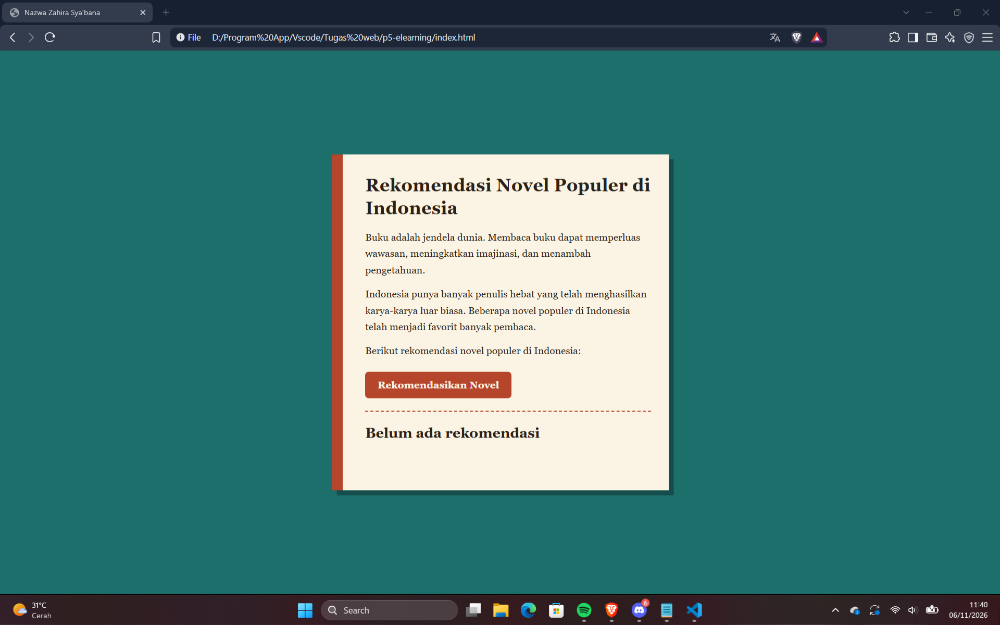
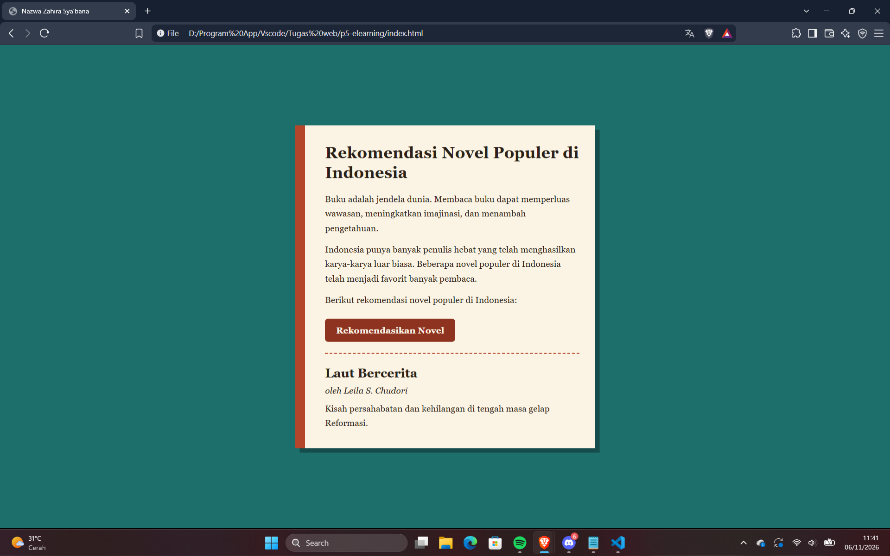

# Tugas 5 E-Learning Website Programming 

Nama: Nazwa Zahira Sya'bana
NIM: 24552011110

## Deskripsi
Website satu halaman bertema judul novel populer Indonesia.

## Fitur
- Judul halaman "Nama Mahasiswa"
- 1 heading dan 3 paragraf
- Elemen desain: warna background dan warna teks
- Tombol yang menampilkan rekomendasi novel secara acak

## Screenshot

### Tampilan awal

### Setelah tombol diklik
